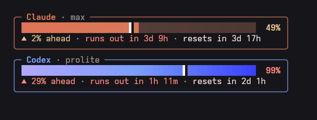

# aiquota

I only **vibecode** this project.

A tiny terminal dashboard for your **weekly** Claude Code, Codex and Antigravity quota — with a
pace marker that tells you whether you are burning through the week faster or
slower than you should.



## Reading it

- The filled part of each bar is how much of this week's quota you have used.
- The white marker `┃` is where you *would* be if you spread the quota evenly
  over the week. Fill past the marker means you are ahead of pace.
- `▲ 2% ahead` / `▼ 10% behind` compares the two. Green is fine, yellow is
  slightly ahead, red is more than 10% ahead or above 90% used.
- `runs out in …` projects your current rate forward; `lasts until reset`
  means you are safe at this pace.

## Requirements

- Python 3.9+ (standard library only, nothing to `pip install`)
- [Claude Code](https://docs.claude.com/en/docs/claude-code) signed in with a
  Claude subscription
- [Codex CLI](https://github.com/openai/codex) on `PATH`, signed in with ChatGPT
- Optional: [Antigravity CLI](https://antigravity.google) signed in with a
  Google account (the card only appears when its token file exists)
- A terminal with truecolor support (kitty, Konsole, WezTerm, GNOME Terminal,
  tmux with truecolor enabled, …)

Claude or Codex can be missing; its card will just show `no data`.

### Several Claude accounts

Extra Claude Code profiles run with `CLAUDE_CONFIG_DIR=~/.claude-<name>` get
their own card, titled `Claude <name>`. Nothing to configure: any
`~/.claude-*/` directory with a `.credentials.json` is picked up.

Plans without an overall weekly limit (for example Team seats) show the
rolling 5-hour session instead, marked `5h window`; the pace marker then
spreads over those 5 hours.

## Install

```sh
git clone https://github.com/nguyenphivn/aiquota.git ~/projects/aiquota
ln -s ~/projects/aiquota/aiquota ~/.local/bin/aiquota
```

Or grab the single file:

```sh
curl -fsSL https://raw.githubusercontent.com/nguyenphivn/aiquota/main/aiquota -o ~/.local/bin/aiquota
chmod +x ~/.local/bin/aiquota
```

Make sure `~/.local/bin` is on your `PATH`.

## Usage

```sh
aiquota          # print once
aiquota -w       # keep it open, redraw every 30 s
aiquota -w 10    # redraw every 10 s
```

Watch mode uses the alternate screen, redraws on terminal resize and exits
cleanly on Ctrl+C. It fits nicely in a narrow tmux pane:

```sh
tmux split-window -h -l 42 aiquota -w
```

The layout adapts to the terminal width (30–72 columns).

### Language

Output is English by default. Set `AIQUOTA_LANG=vi` for Vietnamese (it is also
picked automatically when your locale is `vi_*`).

## How it works

aiquota only **reads** what the official CLIs already have; it never writes to
their credential or config files.

| Provider | Source |
| -------- | ------ |
| Claude   | `GET https://api.anthropic.com/api/oauth/usage` with the OAuth token from `~/.claude/.credentials.json` (or `~/.claude-<name>/.credentials.json`). If that fails (for example HTTP 429), it falls back to the usage snapshot Claude Code caches in `~/.claude.json` (or `~/.claude-<name>/.claude.json`). |
| Codex    | Starts `codex app-server` and calls `account/rateLimits/read`. `CODEX_API_KEY` is removed from the child environment so the ChatGPT login is used. |
| Antigravity | `POST https://cloudcode-pa.googleapis.com/v1internal:loadCodeAssist` and `:fetchAvailableModels` with the token from `~/.gemini/antigravity-cli/antigravity-oauth-token`. Each model has its own quota; the card shows the agent model with the least left, and names it. |

The Claude usage endpoint is rate-limited, so each provider is queried at most
once every 5 minutes; results are cached in `~/.cache/aiquota/`. Watch mode
redraws more often than that only to move the pace marker and countdowns.

## Caveats

- Both data sources are undocumented and may change without notice.
- On macOS, Claude Code keeps its token in the Keychain rather than
  `~/.claude/.credentials.json`, so Claude falls back to the cached snapshot,
  which can be some minutes old (shown as `… old`).
- The Antigravity token lives for about an hour and only the Antigravity CLI
  refreshes it. When it has expired, the card keeps the last numbers it saw
  (marked `… old`) until you open Antigravity again.
- Antigravity's paid plans (Google AI Pro / Ultra) also refill every five
  hours; only the free weekly quota has been checked so far.
- An expired Claude token is not refreshed by aiquota; open Claude Code once
  and it will refresh it.

## License

[MIT](LICENSE)
